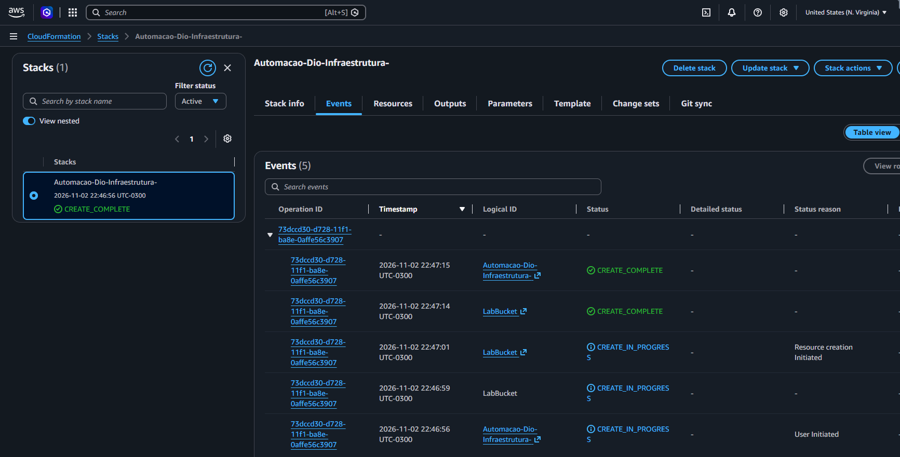
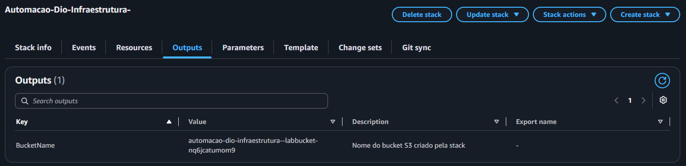
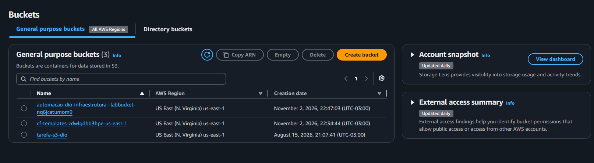
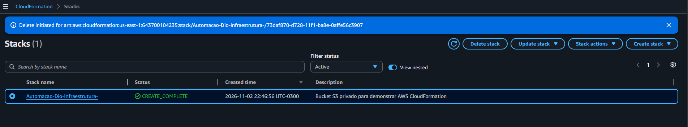

## Resultados e aprendizados

A implantação do template via AWS CloudFormation foi executada e validada com sucesso:

- **Status da stack:** A stack `Automacao-Dio-Infraestrutura-` foi provisionada com sucesso, atingindo o status `CREATE_COMPLETE` em menos de 1 minuto.
- **Segurança aplicada:** O bucket S3 foi criado com bloqueio total de acesso público e criptografia habilitada no servidor (SSE-S3 com AES-256).
- **Consumo de saídas (Outputs):** O nome exclusivo gerado dinamicamente pela AWS (`automacao-dio-infraestrutura--labbucket-nq6jcatumom9`) foi consultado com êxito na aba de saídas da stack.
- **Ciclo de vida e boas práticas:** Após a validação das evidências, a exclusão da stack (`DELETE_IN_PROGRESS` / `DELETE_COMPLETE`) foi realizada, garantindo a destruição limpa dos recursos e evitando custos desnecessários na conta AWS.

Esse exercício consolidou na prática a importância da Infraestrutura como Código (IaC) para reprodutibilidade, segurança e controle automatizado de recursos na nuvem.

## Evidências

Abaixo estão as capturas de tela comprovando a execução prática do laboratório:

### 1. Stack criada com sucesso (`CREATE_COMPLETE`)

### 2. Output com o nome dinâmico do Bucket S3

### 3. Bucket ativo e visível no console do Amazon S3

### 4. Exclusão foi solicitada para Segurança e não gerar custos.

